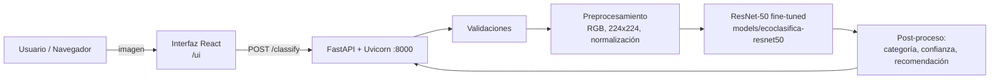

# EcoClasifica — Clasificación Inteligente de Residuos

Proyecto Final — Construcción de Software — **Universidad Continental** (Consolidado 2, Semana 15).

**Equipo DEV**

- **Bryan Alexander Cahuana Mendoza** — DevOps / CI-CD
- **Marco Antonio Bonifacio Ruiz** — Ingeniero ML / IA
- **Jerson Alejandro Baca Medina** — Desarrollador Fullstack
- **Yury Yohan Llanos Luna** — Desarrollador Backend
- **Benjamin Salazar Arenas** — Desarrollador Frontend

---

## 1. Presentación general

| Elemento | Descripción |
|---|---|
| **Nombre** | EcoClasifica |
| **Problemática** | Reconocer el material de un residuo para separarlo correctamente es difícil para la ciudadanía. La separación errónea genera contaminación cruzada en puntos limpios y reduce el aprovechamiento de materiales reciclables. |
| **Objetivo** | Clasificar automáticamente un residuo sólido a partir de una fotografía en 6 categorías y entregar una recomendación de disposición, mediante un modelo ResNet-50 servido por una API REST y una interfaz web. |
| **Público objetivo** | Ciudadanos y estudiantes que desean reciclar correctamente, puntos limpios, instituciones educativas y proyectos de educación ambiental. |

### Stack tecnológico

- **IA / ML:** PyTorch, Torchvision, Hugging Face Transformers (`microsoft/resnet-50`), Pillow, scikit-learn.
- **Backend:** Python 3.11, FastAPI, Uvicorn, python-multipart, Pydantic.
- **Frontend:** React 19, TypeScript, Vite, Tailwind CSS v4, TanStack Query, Axios.
- **DevOps:** Docker, Docker Compose, GitHub Actions (tests, cobertura y lint).

---

## 2. Funcionamiento y arquitectura



### Endpoints de FastAPI

| Método | Ruta | Descripción |
|---|---|---|
| GET | `/` | Información general de la API y enlaces útiles |
| GET | `/health` | Estado del servicio, versión, disponibilidad del modelo afinado y *uptime* |
| GET | `/classes` | Las 6 categorías con emoji y consejo de reciclaje |
| POST | `/classify` | Clasifica una imagen enviada como `multipart/form-data` (campo `file`) |
| POST | `/predict` | Alias de `/classify` |
| POST | `/classify/base64` | Clasifica una imagen en base64 (`{"image_base64": "..."}`) |
| GET | `/ui` | Interfaz web (si existe `frontend/dist`) |
| GET | `/docs`, `/redoc` | Documentación OpenAPI (Swagger / ReDoc) |

### Validaciones

1. Archivo no vacío y tamaño máximo de **10 MB** (HTTP 413 si se excede; 15 MB de cadena para base64).
2. Tipo MIME permitido: `image/jpeg`, `image/png`, `image/webp`, `image/bmp`.
3. Extensión permitida: `.jpg`, `.jpeg`, `.png`, `.webp`, `.bmp`.
4. Inspección de *magic bytes* e integridad con Pillow (evita archivos suplantados).
5. Dimensiones entre **10×10** y **8192×8192** píxeles (protección contra bombas de descompresión).
6. Base64 estricto (`validate=True`). Los errores de validación devuelven HTTP 400/413 con un `detail` descriptivo.

### Interfaz

SPA en React con diseño *Glassmorphism*: subir archivo, arrastrar y soltar, cámara y pegado con `Ctrl + V`, escáner animado, barra de inferencia y recomendación con efecto *typewriter*. En Docker, la API sirve el build de `frontend/dist` y la interfaz queda en `http://localhost:8000/ui`.

### Flujo de inferencia

1. El cliente envía la imagen a `POST /classify`.
2. La API valida el archivo y lo convierte a RGB.
3. El preprocesamiento redimensiona a 224×224 y normaliza con media/desviación de ImageNet.
4. El modelo ResNet-50 afinado calcula los *logits* y se aplica *softmax*.
5. El post-proceso devuelve categoría, confianza, emoji, recomendación y las probabilidades de las 6 clases.

Ejemplo de respuesta:

```json
{
  "error": false,
  "categoria": "Metal",
  "confianza": 0.92,
  "emoji": "🥫",
  "recomendacion": "RECICLABLE - Enjuaga latas y enlatados antes de reciclar...",
  "todas_las_predicciones": {"Metal": 0.92, "Plástico": 0.03},
  "modelo_afinado": true
}
```

### Configuración por variables de entorno (sin rutas absolutas)

| Variable | Valor por defecto | Uso |
|---|---|---|
| `ECOCLASIFICA_MODEL_PATH` | `<raíz del proyecto>/models/ecoclasifica-resnet50` | Carpeta con los archivos del modelo |
| `ECOCLASIFICA_FRONTEND_DIST` | `<raíz del proyecto>/frontend/dist` | Build de la interfaz web |

En el contenedor se fijan a `/app/models/ecoclasifica-resnet50` y `/app/frontend/dist`.

---

## 3. Componente de IA

- **Modelo:** ResNet-50 (`microsoft/resnet-50`, preentrenado en ImageNet-1k) **fine-tuned** sobre TrashNet (2 527 imágenes, partición 80/20) con *transfer learning* durante 5 épocas en CPU.
- **Justificación técnica:** ResNet-50 ofrece un buen equilibrio entre precisión y costo de inferencia en CPU; sus conexiones residuales permiten entrenar redes profundas de forma estable, y el *transfer learning* aprovecha características visuales ya aprendidas, lo que es clave con un dataset pequeño.
- **Entrada:** imagen RGB redimensionada a **224×224** y normalizada (media `[0.485, 0.456, 0.406]`, desviación `[0.229, 0.224, 0.225]`).
- **Salida:** probabilidades para **6 clases**:

| ID | Etiqueta del modelo | Categoría |
|---|---|---|
| 0 | `cardboard` | Cartón |
| 1 | `glass` | Vidrio |
| 2 | `metal` | Metal |
| 3 | `paper` | Papel |
| 4 | `plastic` | Plástico |
| 5 | `trash` | Basura general |

- **Archivos del modelo** (`models/ecoclasifica-resnet50/`): `model.safetensors` (~94.3 MB), `config.json`, `label_mapping.json`, `preprocessor_config.json`.
- **Gestión de los pesos del modelo (Git vs. Docker Hub):** Para mantener el repositorio Git ligero y evitar superar el límite de archivos pesados de GitHub, la carpeta `models/` está excluida en `.gitignore`. Sin embargo, **los 4 archivos del modelo afinado ya vienen empaquetados dentro de la imagen oficial publicada en Docker Hub (`yury1289/ecoclasifica:latest`)**, por lo que cualquier integrante del equipo o evaluador puede ejecutar el sistema completo con el modelo entrenado sin descargar pesos aparte.
- **Métricas actuales (evaluación):** Accuracy ≈ **58.42 %**, F1 macro ≈ **0.4709**.

### Limitaciones actuales

- Rendimiento moderado: solo 5 épocas, entrenamiento en CPU y dataset pequeño.
- TrashNet tiene fondos limpios y un objeto por imagen; con fondos complejos, varios objetos o poca luz la precisión baja.
- Clasifica por material, no por estado (suciedad, mezcla de materiales) ni por reglas de reciclaje locales.
- La clase `trash` es heterogénea y la más difícil de predecir.
- No hay umbral de rechazo: siempre devuelve una de las 6 clases, aunque la confianza sea baja.
- Si falta el modelo afinado en una ejecución local fuera de Docker, el backend recurre automáticamente a ResNet-50 base con cabeza sin entrenar y descarga pesos de Hugging Face (requiere internet); el campo `modelo_afinado_disponible` de `/health` lo indica.

---

## 4. Implementación de Docker

Esta sección cubre los 5 puntos requeridos en el apartado **4. Implementación de Docker** de la consigna de la Semana 15:

### 4.1. Presentación y explicación del `Dockerfile`

El archivo `Dockerfile` empaqueta en una sola unidad portable el backend FastAPI, la interfaz web React compilada y el modelo ResNet-50 afinado:

1. **Imagen base (`FROM python:3.11-slim`):** Utiliza una distribución ligera de Debian con Python 3.11 para minimizar el tamaño y la superficie de ataque del contenedor.
2. **Variables de entorno (`ENV`):**
   - `PYTHONDONTWRITEBYTECODE=1` y `PYTHONUNBUFFERED=1`: evitan archivos `.pyc` y habilitan logs en tiempo real.
   - `ECOCLASIFICA_MODEL_PATH=/app/models/ecoclasifica-resnet50`: ruta interna del checkpoint afinado.
   - `ECOCLASIFICA_FRONTEND_DIST=/app/frontend/dist`: ruta interna del build de producción de React servido en `/ui`.
3. **Dependencias del sistema (`RUN apt-get ...`):** Instala `libgl1` y `libglib2.0-0` (necesarias para Pillow/Torchvision) y limpia la caché de `apt`.
4. **Dependencias de Python (`COPY requirements.txt .` + `RUN pip install ...`):** Se copian e instalan antes del código fuente para aprovechar la caché de capas de Docker.
5. **Integración de componentes (`COPY`):**
   - `COPY src/ ./src/`: lógica de negocio y API REST FastAPI.
   - `COPY frontend/dist/ ./frontend/dist/`: interfaz gráfica compilada (SPA React + Vite).
   - `COPY models/ecoclasifica-resnet50/ ./models/ecoclasifica-resnet50/`: pesos entrenados (`model.safetensors`), configuración y mapeo de las 6 clases.
6. **Puerto y comando de arranque (`EXPOSE 8000` + `CMD`):** Expone el puerto `8000` e inicia el servidor ASGI con `uvicorn src.fastapi_app:app --host 0.0.0.0 --port 8000`.

### 4.2. Construcción de la imagen Docker

Desde la raíz del proyecto (`Proyecto_Entrenamiento_IA`), la imagen se construye y etiqueta hacia el repositorio oficial de Docker Hub (`yury1289/ecoclasifica:latest`):

```bat
docker build -t ecoclasifica:latest .
docker tag ecoclasifica:latest yury1289/ecoclasifica:latest
```

Para publicar la imagen en Docker Hub:

```bat
docker login -u yury1289
docker push yury1289/ecoclasifica:latest
```

### 4.3. Ejecución del contenedor

Cualquier integrante del equipo o el docente puede descargar y ejecutar el contenedor directamente desde Docker Hub en Windows (`cmd.exe` o PowerShell):

```bat
docker pull yury1289/ecoclasifica:latest
docker run -d --name ecoclasifica -p 8000:8000 yury1289/ecoclasifica:latest
```

Comandos útiles de administración del contenedor:

```bat
docker ps --filter "name=ecoclasifica"
docker logs -f ecoclasifica
docker rm -f ecoclasifica
```

### 4.4. Demostración del funcionamiento del sistema desde el contenedor

Con el contenedor activo en el puerto `8000`, el sistema completo se demuestra en tiempo real desde:

- **Interfaz gráfica web (React SPA):** <http://localhost:8000/ui> (permite subir o arrastrar una imagen de residuo, usar la cámara o pegar con `Ctrl + V` y visualizar la categoría, porcentaje de confianza, desglose de las 6 clases y recomendación ecológica).
- **Documentación interactiva Swagger (OpenAPI):** <http://localhost:8000/docs> (permite probar en vivo `GET /health`, `GET /classes`, `POST /classify` y `POST /classify/base64`).
- **Verificación de estado (Health Check):** <http://localhost:8000/health> → devuelve `{"status": "ok", "servicio": "EcoClasifica API", "modelo_afinado_disponible": true, ...}`.

También se puede verificar desde PowerShell:

```powershell
Invoke-RestMethod http://localhost:8000/health
Invoke-RestMethod http://localhost:8000/classes
curl.exe -X POST -F "file=@C:\ruta\a\residuo.jpg" http://localhost:8000/classify
```

### 4.5. Uso de Docker Compose

El proyecto incluye el archivo `docker-compose.yml` para automatizar y estandarizar el despliegue declarativo del servicio `ecoclasifica` sin tener que recordar parámetros manuales de `docker run`:

- **¿Por qué corresponde usar Docker Compose en EcoClasifica?**
  1. **Configuración declarativa en un solo archivo:** Define el nombre del contenedor (`ecoclasifica`), el mapeo de puertos (`"8000:8000"`), las variables de entorno (`ECOCLASIFICA_MODEL_PATH` y `ECOCLASIFICA_FRONTEND_DIST`) y la política de reinicio automático (`restart: unless-stopped`).
  2. **Monitoreo de salud integrado (`healthcheck`):** Verifica periódicamente desde dentro del contenedor que `http://localhost:8000/health` responda HTTP 200, reportando el estado `(healthy)` en `docker compose ps`.
  3. **Portabilidad con Docker Hub (`yury1289/ecoclasifica:latest`):** Usa `image: ${DOCKER_IMAGE:-yury1289/ecoclasifica:latest}`, lo que permite tanto descargar la imagen lista desde Docker Hub como reconstruirla localmente con `--build`.

#### Comandos con Docker Compose (`cmd.exe` o PowerShell, desde la carpeta del proyecto)

```bat
REM 1. Descargar la imagen publicada en Docker Hub y levantar el servicio en segundo plano
docker compose pull
docker compose up -d

REM 2. Verificar estado del servicio y healthcheck (Up / healthy)
docker compose ps

REM 3. Ver logs en tiempo real
docker compose logs -f

REM 4. Detener y eliminar el contenedor y la red creada por Compose
docker compose down
```

*(Si se realizaron cambios locales en el código o modelo y se desea reconstruir la imagen con Compose: `docker compose up -d --build`).*

---

## 5. Instalación y desarrollo local sin Docker

Si algún integrante desea ejecutar el proyecto directamente con Python en su máquina y obtener los pesos afinados sin reentrenar desde cero, puede extraer la carpeta `models/ecoclasifica-resnet50` desde la imagen de Docker Hub:

```bat
docker pull yury1289/ecoclasifica:latest
docker create --name temp_eco yury1289/ecoclasifica:latest
docker cp temp_eco:/app/models/ecoclasifica-resnet50 ./models/ecoclasifica-resnet50
docker rm temp_eco
```

Luego, crear el entorno virtual y levantar el servidor FastAPI (que también servirá `/ui` gracias a `frontend/dist`):

```powershell
python -m venv venv
.\venv\Scripts\Activate.ps1
pip install -r requirements.txt
python -m uvicorn src.fastapi_app:app --host 0.0.0.0 --port 8000 --reload
```

- **Frontend en modo desarrollo (Vite):** `cd frontend; npm install; npm run dev` (<http://localhost:5173>).
- **Pruebas unitarias y estilo:**
  ```powershell
  python -m unittest discover -s tests -p "test_*.py" -v
  python -m flake8 src/ --max-line-length=120
  ```
- **Entrenamiento desde cero (opcional):**
  ```powershell
  python preparar_datos.py
  python training/train.py --epochs 5
  ```

## 6. Estructura del repositorio

```text
Proyecto_Entrenamiento_IA/
├── Dockerfile              # Imagen de producción (FastAPI + React build + ResNet-50)
├── docker-compose.yml      # Orquestación del contenedor en el puerto 8000:8000
├── .dockerignore           # Exclusión de archivos temporales y pesados en el contexto de build
├── requirements.txt        # Dependencias de Python (FastAPI, Uvicorn, PyTorch, Transformers, Pillow)
├── src/                    # Backend y lógica de negocio (fastapi_app.py, routes.py, model.py, preprocess.py, postprocess.py)
├── frontend/               # SPA en React 19 + TypeScript + Vite (frontend/dist/ = build de producción servido en /ui)
├── models/ecoclasifica-resnet50/   # Pesos afinados (incluidos en yury1289/ecoclasifica:latest)
├── training/               # Scripts de entrenamiento y evaluación (train.py, evaluate.py, config.json)
├── tests/                  # Suite de pruebas unitarias (unittest + TestClient)
└── .github/workflows/ci.yml # Pipeline CI/CD en GitHub Actions (tests, cobertura >=60% y flake8)
```

